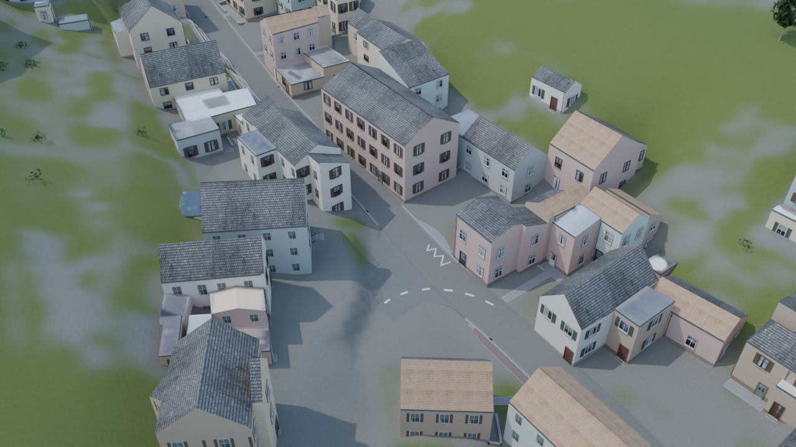

# Road to Assetto

Ein selbst gehosteter Streckengenerator mit Weboberfläche für **Assetto Corsa**.
Der aktuelle Prototyp baut die rund 701 m lange **Langstraße in Bad Soden-Altenhain**
oder auswählbare Teilstrecken ab 120 m. Eine weltweite Adresssuche ist noch nicht enthalten.



## Installation

### Unraid

Die fertige Vorlage und die Installationsschritte stehen in **[unraid/README.md](unraid/README.md)**.
Das Image enthält Blender, die vorbereiteten Altenhain-Geodaten und die Materialien.
Für Aufträge, Einstellungen und Ergebnisse wird nur ein persistenter Appdata-Ordner benötigt.

- Image: `ghcr.io/gottschalkfelix4-source/road-to-assetto:latest`
- Architektur: `linux/amd64`
- Weboberfläche: HTTP auf Containerport **8765**
- Keine GPU oder Assetto-Corsa-Installation auf dem Server erforderlich

### Docker Compose

```sh
git clone https://github.com/gottschalkfelix4-source/road-to-assetto.git
cd road-to-assetto
docker compose pull
docker compose up -d
```

Anschließend [http://localhost:8766](http://localhost:8766) öffnen. Für Zugriff aus dem
Heimnetz eine lokale `.env` mit `ROADTOASSETTO_BIND_IP=0.0.0.0` anlegen.
Details zu Speicher, Updates, Selbstbau und Datenpaket: **[DOCKER.md](DOCKER.md)**.
TLS bleibt bei einem vorhandenen Reverse Proxy. Die Anwendung bringt keine eigene
Benutzeranmeldung mit; den Zugang auf das eigene Netz oder einen geschützten Proxy beschränken.

## Strecke erstellen

1. Einen Abschnitt auf der Karte wählen und Name, Breitenfaktor sowie Details einstellen.
2. Den Auftrag starten und die Vorschauen ansehen.
3. Das fertige ZIP herunterladen und in Assetto Corsa Content Manager importieren.
4. In **Practice / Freies Training** fahren.

Jeder Auftrag hat eine eigene Track-ID. Er verändert keine vorhandene Strecke und
keine Spiel- oder Lenkradeinstellungen. Die Aufträge werden nacheinander verarbeitet.

## Was der Generator verwendet

- OpenStreetMap-Straßen, amtliches DGM1/DOM1, DOP20 und LoD2-Gebäude aus Hessen.
- Eine am Luftbild nachgeführte Mittelachse mit wechselnder Straßenbreite.
  Die Einstellung **100 % / 6 m** bezeichnet das natürliche Breitenprofil, keine konstante Breite.
- Deutsche Straßendetails, dokumentierte Markierungen und Einmündungen,
  Pflasteranschlüsse, Stützmauern, Treppen und geeignete Zufahrten.
- Gemeinsame Geländeplanung und geschlossene Hausunterseiten mit Kellerhüllen und Sockeln.
- Freie Oberflächenmaterialien, generierte Fenster-/Türatlanten und eine zugeordnete
  historische CC0-Fotofassade. Die übrigen Fassadendetails sind abgeleitete Kulisse.
- KN5-Export und Blender-Vorschauen mit derselben generierten Geometrie.

Die Grundstücksdetails sind **keine Vermessung oder fotografische Rekonstruktion**.
Der Prototyp ist für private Streckentests gedacht; KI erzeugt keine fehlenden
Originalansichten. Alle Quellen und Grenzen sind in **[THIRD_PARTY.md](THIRD_PARTY.md)** dokumentiert.
Google-Street-View-Bilder sind nicht enthalten.

## Optionale KI-Materialien

Anbieter, Images-API-Adresse, Modell und API-Schlüssel können später im Webinterface
unter **KI-Anbieter** eingetragen werden. Ohne Anbieterzugang funktioniert der Generator
mit den mitgelieferten Materialien. Ein ChatGPT-Login ist nicht implementiert.

Die optionale Funktion erzeugt generische Putz-, Dach- und Asphaltmaterialien.
Sie überträgt feste Materialbeschreibungen, keine Geodaten oder Ortsfotos. Anbietergebühren
können anfallen. Schlüssel und Cache bleiben im persistenten `/data`-Volume und gehören
weder in dieses Repository noch in ein Image oder Streckenpaket.

## Entwicklung und Veröffentlichungen

```sh
# Image mit den veröffentlichten, per SHA256 geprüften Geodaten selbst bauen
docker compose build
```

Der Quellcode liegt in `roadtoassetto/`, `webapp/` und `scripts/`. Das versionierte
Datenpaket wird separat als GitHub-Release bereitgestellt; seine URL und Prüfsumme stehen
in `docker/dataset.json`. Aufträge, API-Einstellungen, lokale Programme und große erzeugte
Modelle werden nicht ins Repository übernommen.

GitHub Actions prüft den Code und veröffentlicht das Containerimage für den Hauptbranch
und Versionstags. Die Unraid-Vorlage zeigt auf `latest`; ein Versions-Tag kann für feste
Installationen gewählt werden. Der aktuelle Generatorstand ist **0.11.0**.

## Lizenz

Der Projektcode steht unter **[Apache-2.0](LICENSE)**. Die Lizenz gilt nicht pauschal
für mitgelieferte Geodaten und Fremdmaterialien: Diese behalten ihre jeweiligen
Lizenzen und Herkunftsnachweise, insbesondere ODbL, Datenlizenz Deutschland Zero 2.0
und CC0. Siehe [THIRD_PARTY.md](THIRD_PARTY.md).
